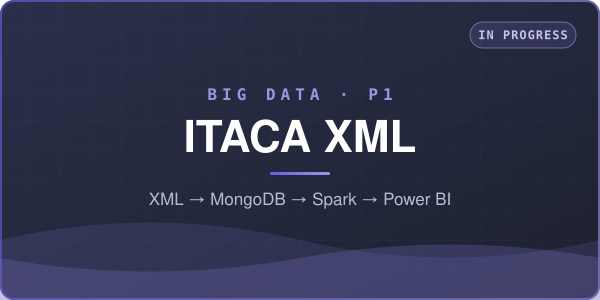
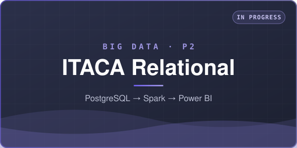
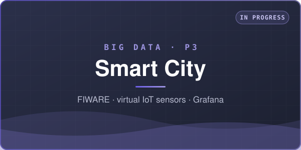
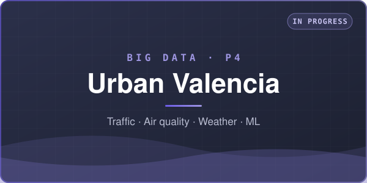

<!-- Hero Section -->

  

  

<h3 align="center">Mario Aguilar Avila · Data Engineer</h3>

 

<!-- Tech Stack: bento grid, 8 columns (generated) -->

<table>
  <tr>
    <th colspan="3">Data Pipelines</th>
    <th colspan="4">Databases</th>
    <th colspan="1">IoT</th>
  </tr>
  <tr>
    <td align="center" width="90"> Airflow</td>
    <td align="center" width="90"> Kafka</td>
    <td align="center" width="90"> PySpark</td>
    <td align="center" width="90"> PostgreSQL</td>
    <td align="center" width="90"> InfluxDB</td>
    <td align="center" width="90"> Vector DB</td>
    <td align="center" width="90"> MySQL</td>
    <td align="center" width="90"> FIWARE</td>
  </tr>
  <tr>
    <td align="center" width="90"> NiFi</td>
    <td align="center" width="90"> REST APIs</td>
    <td align="center" width="90"> JDBC</td>
    <td align="center" width="90"> SQLite</td>
    <td align="center" width="90"> MariaDB</td>
    <td align="center" width="90"> MongoDB</td>
    <td align="center" width="90"> Neo4j</td>
    <td align="center" width="90"> CrateDB</td>
  </tr>
  <tr>
    <th colspan="3">Languages &amp; Lakehouse</th>
    <th colspan="3">DevOps &amp; Cloud</th>
    <th colspan="2">Observability &amp; AI</th>
  </tr>
  <tr>
    <td align="center" width="90"> Python</td>
    <td align="center" width="90"> SQL</td>
    <td align="center" width="90"> Java</td>
    <td align="center" width="90"> AWS</td>
    <td align="center" width="90"> Linux</td>
    <td align="center" width="90"> Docker</td>
    <td align="center" width="90"> Power BI</td>
    <td align="center" width="90"> Grafana</td>
  </tr>
  <tr>
    <td align="center" width="90"> Iceberg</td>
    <td align="center" width="90"> HDFS</td>
    <td align="center" width="90"> MinIO</td>
    <td align="center" width="90"> GitHub</td>
    <td align="center" width="90"> Git</td>
    <td align="center" width="90"> GitLab</td>
    <td align="center" width="90"> Jupyter</td>
    <td align="center" width="90"> Prometheus</td>
  </tr>
  <tr>
    <td align="center" width="90"> SeaweedFS</td>
    <td align="center" width="90"> Parquet</td>
    <td align="center" width="90"> JSON</td>
    <td align="center" width="90"> GitHub Actions</td>
    <td align="center" width="90"> MkDocs</td>
    <td align="center" width="90"> Kubernetes</td>
    <td align="center" width="90"> Claude Code</td>
    <td align="center" width="90"> OpenCode</td>
  </tr>
</table>

<!-- Contact line -->

<b>Open to Data Engineering opportunities and collaborations.</b> Have a project or an idea? Let's connect.

<!-- Contact buttons: left / center / right -->

  
  
  

<!-- About -->

  

<h2 align="center">✦ <em>Data Engineer · Data Analyst · Analytics Engineer</em> ✦</h2>

  Building <b>Big Data</b> projects with <b>PySpark</b>, <b>Kafka</b> and <b>Airflow</b>, from batch to <b>Structured Streaming</b>.  
  Learning <b>lakehouse architectures</b> with <b>Apache Iceberg</b>, <b>IoT / Smart Cities</b> data with <b>FIWARE</b> and <b>RAG</b> with vector databases.  
  Focused on <b>scalable data pipelines</b>, <b>data quality &amp; lineage</b> and <b>MLOps</b>, turning raw data into decisions.

<!-- GitHub Activity -->
<h2 align="center">✦ <em>GitHub Activity</em> ✦</h2>

  
  

 

<!-- GitHub contribution snake -->

  <picture>
    <source media="(prefers-color-scheme: dark)" srcset="https://raw.githubusercontent.com/maavcode/maavcode/output/github-contribution-grid-snake-dark.svg" />
    <source media="(prefers-color-scheme: light)" srcset="https://raw.githubusercontent.com/maavcode/maavcode/output/github-contribution-grid-snake.svg" />
    
  </picture>

<!-- Projects (generated) -->
<h2 align="center">✦ <em>Featured Projects</em> ✦</h2>

<table>
  <tr>
    <td width="50%" valign="top">
      
      <h3>ITACA XML - In progress</h3>
      
Academic analytics dashboard from real <b>ITACA</b> XML exports: Python ingestion with anonymised student IDs, <b>MongoDB</b> storage, <b>Spark</b> ETL and a <b>Power BI</b> report.

      
&nbsp;&nbsp;&nbsp;&nbsp;

      
<a href="https://github.com/maavcode/bigdata-p1-itaca"><b>Repo</b></a>

    </td>
    <td width="50%" valign="top">
      
      <h3>ITACA Relational - In progress</h3>
      
The same academic dashboard built from a relational source: <b>PostgreSQL</b> ingestion to JSON (7k students, 100k+ grades), <b>Spark</b> ETL and <b>Power BI</b>.

      
&nbsp;&nbsp;&nbsp;&nbsp;

      
<a href="https://github.com/maavcode/bigdata-p2-itaca"><b>Repo</b></a>

    </td>
  </tr>
  <tr>
    <td width="50%" valign="top">
      
      <h3>Smart City with FIWARE - In progress</h3>
      
Simulated smart city with virtual sensors on the <b>FIWARE</b> platform: real-time data capture, storage and visualisation in <b>Grafana</b>.

      
&nbsp;

      
<a href="https://github.com/maavcode/bigdata-p3-smart_city_fiware"><b>Repo</b></a>

    </td>
    <td width="50%" valign="top">
      
      <h3>Urban Valencia - In progress</h3>
      
End-to-end <b>batch + streaming</b> pipeline over Valencia open data (traffic, air quality, weather) joined with <b>Spark</b>, ending in NO₂ and traffic <b>prediction models</b>.

      
&nbsp;&nbsp;

      
<a href="https://github.com/maavcode/bigdata-p4-urban_valencia"><b>Repo</b></a>

    </td>
  </tr>
  <tr>
    <td width="50%" valign="top">
      
      <h3>VeMoGO · Desktop</h3>
      
Final degree project. Desktop management app (products, sales, services, clients and employees) built with <b>WPF</b> on <b>.NET 9</b>, <b>Entity Framework Core</b> and <b>MySQL</b>.

      
&nbsp;&nbsp;

      
<a href="https://github.com/maavcode/project-VeMoGO/tree/main/desktopApp"><b>Repo</b></a>

    </td>
    <td width="50%" valign="top">
      
      <h3>VeMoGO · Mobile</h3>
      
Final degree project. <b>Android</b> client app in <b>Kotlin</b> with <b>Jetpack Compose</b>, backed by a <b>Spring Boot</b> REST API (JPA, bcrypt auth) over the same <b>MySQL</b> database.

      
&nbsp;&nbsp;&nbsp;&nbsp;

      
<a href="https://github.com/maavcode/project-VeMoGO/tree/main/mobileApp"><b>Repo</b></a>

    </td>
  </tr>
</table>
<!-- /Projects -->

<!-- Footer -->

  

